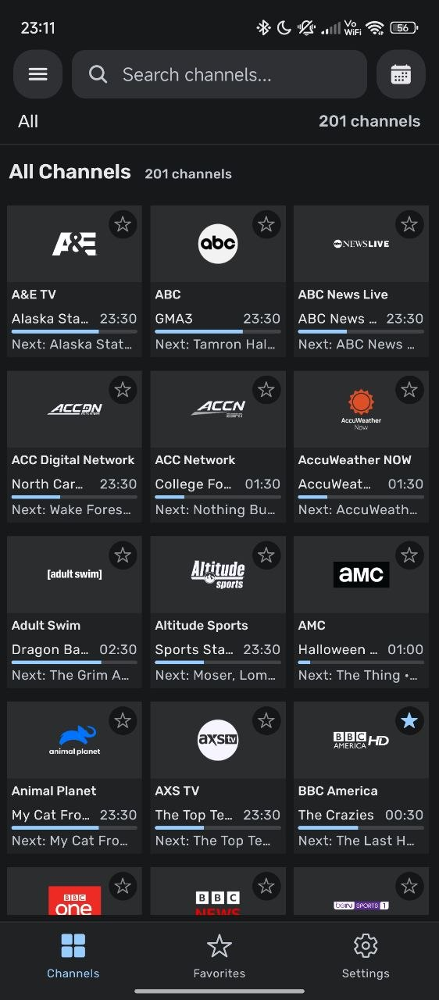
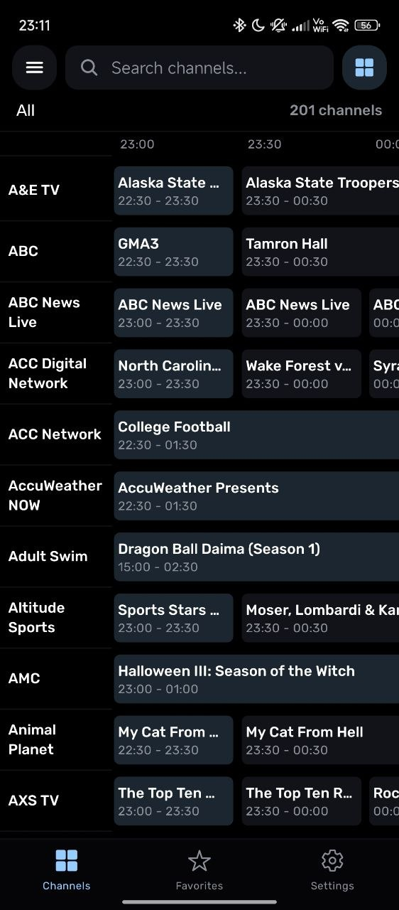
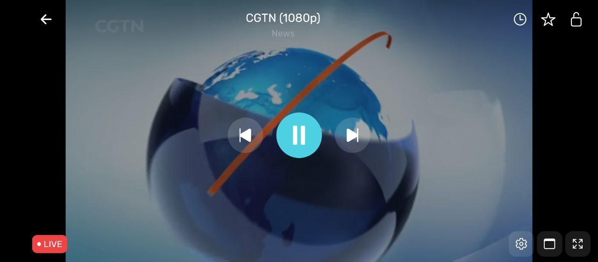
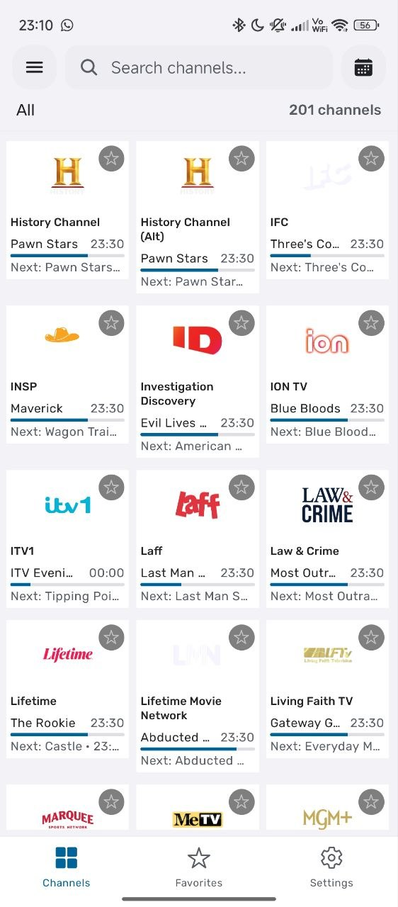
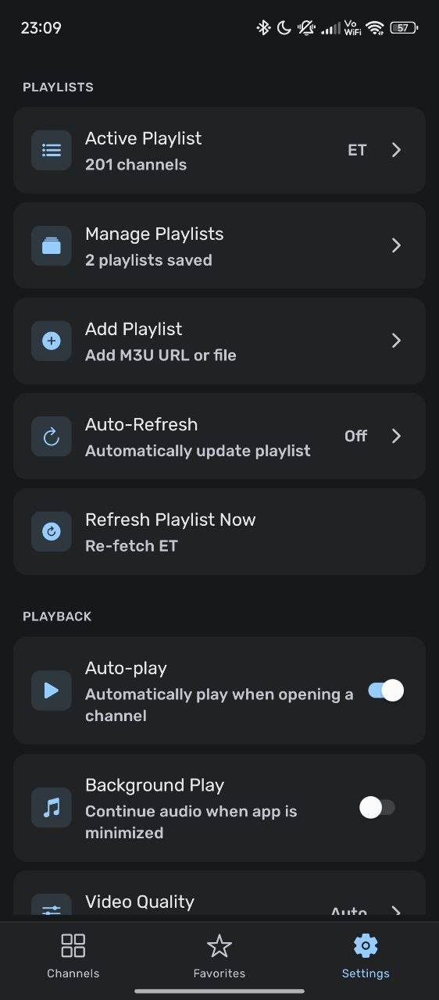
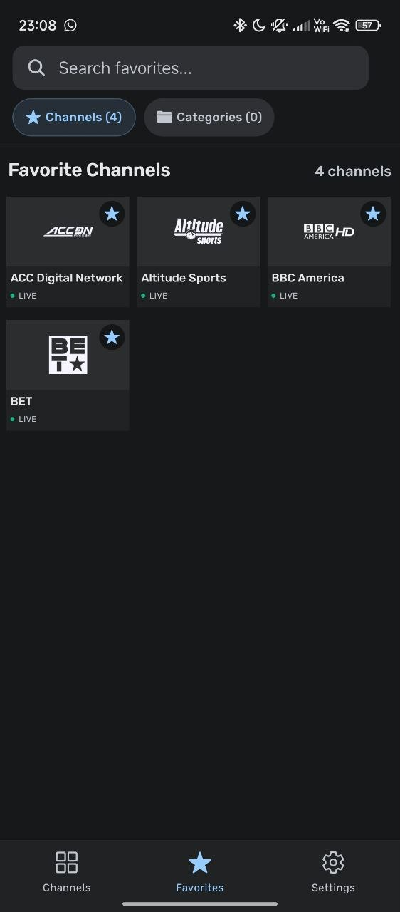
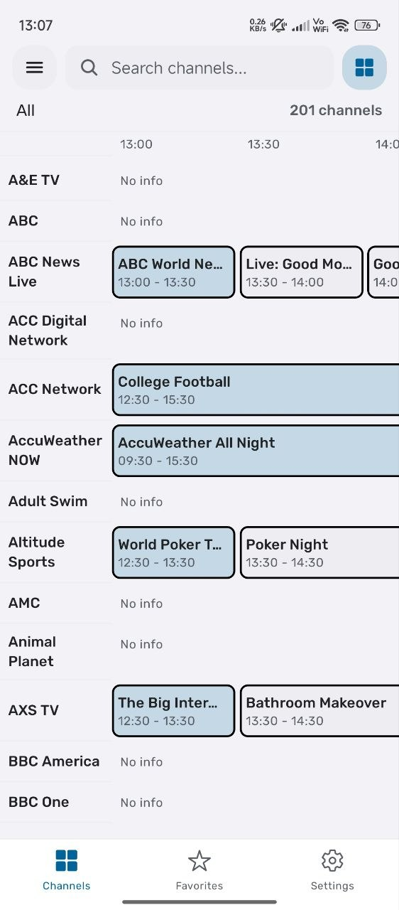
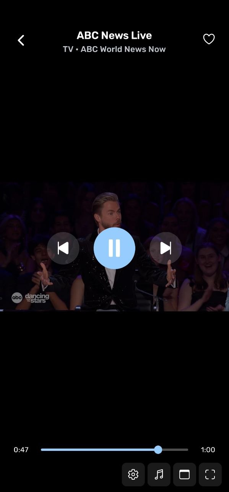
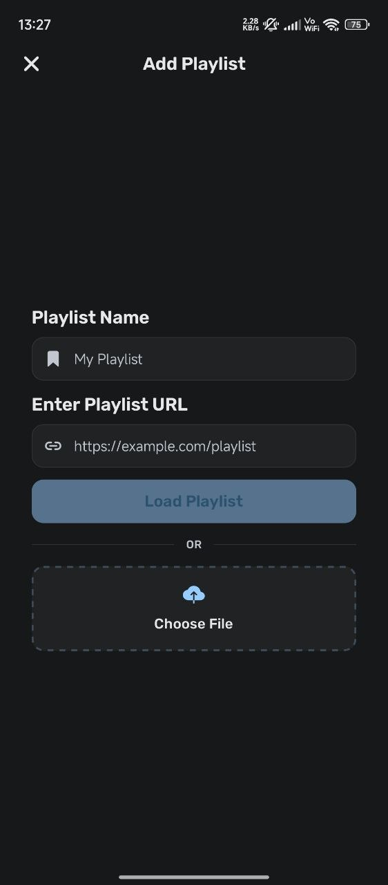

<div align="center">

# 📺 Prysm

**A modern, lightweight M3U IPTV player for Android &amp; Android TV.**

[](#-supported-platforms)
[](#-tech-stack)
[](#-tech-stack)
[](../../releases)
[](#-license)

[**Download**](../../releases/latest) · [**Features**](#-features) · [**Screenshots**](#-screenshots) · [**Getting Started**](#-getting-started) · [**Contributing**](#-contributing)

</div>

---

Prysm is an **IPTV player** with a purpose-built native playback engine and an interface that feels at home on a 10-foot screen — while staying just as polished on a phone.

Every stream is yours: no content, no subscriptions, no accounts. Bring your own M3U source and go.

---

## ✨ Features

<table>
<tr>
<td width="50%">

### 📡 Playlists
- **M3U / M3U8 / PLS / XSPF / JSON** support
- Load from **URL or local file**
- **Multiple playlists** — save, switch, and manage
- **Auto-refresh** — off, 5 min, 15 min, daily, or custom
- Fast channel browsing backed by **FlashList** virtualization
- **Categories** with filtering + remembered last category

### 🎬 Playback
- Custom **native player** — Media3/ExoPlayer with **VLC fallback**
- Switch engines **globally or per-channel**
- **HLS**, **DASH (MPD)**, **Smooth Streaming (MSS/ISM)**
- **Quality selection** — auto or forced, plus manifest-derived ladders
- **Aspect ratio**, audio track &amp; subtitle track selection
- Live + VOD scrubbing, **recent channels**, in-player **favorites**
- **Picture-in-Picture** &amp; **background audio**

### 🔐 DRM
- **Widevine**, **PlayReady**, **ClearKey**
- License server URL **or** embedded license key
- Custom DRM headers, certificate URL, raw **PSSH**
- **Auto-extracts DRM** from the manifest when the playlist omits it

</td>
<td width="50%">

### 📅 EPG (XMLTV)
- **Auto-detected** from M3U `tvg-id` / `x-tvg-url`
- **Now / Next** on channel cards and in the player
- Full **program guide** — grid on TV, list on mobile
- Handles **large gzip-compressed** XMLTV feeds without freezing
- Manual EPG source + one-tap refresh

### 📡 Network Stream Player
- Play **any URL directly** — no playlist needed
- Custom HTTP headers: **Cookie, Referer, Origin**
- **User-Agent** presets
- Full **DRM** configuration on the fly

### 🎨 Themes
- **Dark**, **Light**, and true **Pitch Black** (AMOLED)
- **Material You** dynamic color *(Android 12+)*
- **Manual seed color** — pick a base color for the whole app
- Adjustable **text size**

### 📺 Android TV
- **3-column layout** with a live *Now Showing* panel + top navigation
- Full **D-pad / remote** navigation with clear focus rings

</td>
</tr>
</table>

### 🧰 Also included
- **In-app updater** — check for and install new APKs without leaving the app
- **In-app log viewer** + crash handler for painless bug reports
- **Per-ABI APKs** — `arm64-v8a`, `armeabi-v7a`, `x86`, `x86_64`, plus a universal build

---

## 📱 Screenshots

### Mobile

<table>
<tr>
<td align="center"><br><sub><b>Channels</b> — now/next on cards</sub></td>
<td align="center"><br><sub><b>Program guide</b></sub></td>
<td align="center"><br><sub><b>Player</b> — landscape</sub></td>
</tr>
<tr>
<td align="center"><br><sub><b>Light theme</b></sub></td>
<td align="center"><br><sub><b>Settings</b></sub></td>
<td align="center"><br><sub><b>Favorites</b></sub></td>
</tr>
</table>

<details>
<summary><b>More mobile screenshots</b></summary>
<br>

<table>
<tr>
<td align="center"><br><sub>Guide — light</sub></td>
<td align="center"><br><sub>Player — light</sub></td>
<td align="center"><br><sub>Player settings</sub></td>
</tr>
<tr>
<td align="center"><br><sub>Categories</sub></td>
<td align="center"><br><sub>Add playlist</sub></td>
<td></td>
</tr>
</table>

</details>

## 📥 Download

Grab the latest build from **[GitHub Releases](../../releases/latest)**.

| APK | Use it on |
| --- | --- |
| `prysm-<version>-arm64-v8a.apk` | Most modern phones &amp; boxes (recommended) |
| `prysm-<version>-armeabi-v7a.apk` | Older 32-bit ARM devices |
| `prysm-<version>-x86_64.apk` | x86_64 emulators &amp; some Chromebooks |
| `prysm-<version>-x86.apk` | 32-bit x86 emulators |
| `prysm-<version>-universal.apk` | When you're unsure — contains every ABI |

> **Android TV:** install the same APK, then add a channel from the TV launcher's

---

## 🎯 Supported Platforms

| Platform | Status |
| --- | --- |
| 🤖 **Android** (phone / tablet) | ✅ Fully supported |
| 📺 **Android TV** | ✅ Fully supported |
| 🍎 iOS | ❌ Not a target |
| 🌐 Web | ❌ Not a target |

---

## 🚀 Getting Started

### 📋 Requirements
- **Node.js** 18+
- **JDK 21** &amp; **Android Studio** (for an emulator or a physical device)

### 📦 Setup

```bash
git clone https://github.com/dereferencex/prysm.git
cd prysm
npm install
```

### ▶️ Run

```bash
npm start          # Expo dev server
npm run android    # Build & install on a connected device/emulator
```

### 🏗️ Build a release APK

```bash
npx expo prebuild --no-install
cd android && ./gradlew assembleRelease
```

Per-ABI APKs land in `android/app/build/outputs/apk/release/`. Pushing a `v*` tag
also triggers the **[GitHub Actions workflow](.github/workflows/build-apk.yml)**, which
builds, signs, and publishes every ABI to the release automatically.

---

## 🛠️ Tech Stack

| Layer | Choice |
| --- | --- |
| Framework | **Expo SDK 54** · React Native (`react-native-tvos` fork) |
| Language | **TypeScript** · **Kotlin** |
| Navigation | React Navigation 7 |
| Lists | **FlashList** virtualization |
| Player | **Custom native module** — Media3/ExoPlayer + VLC (`libvlc`) |
| Styling | Theme system + `@material/material-color-utilities` |
| State | React Context · TanStack React Query |
| Storage | AsyncStorage |
| Validation | Zod |

### 📂 Native modules

Prysm ships its own Expo modules rather than leaning on config plugins alone:

| Module | Purpose |
| --- | --- |
| [`tv-player`](modules/tv-player) | ExoPlayer/VLC engine, DRM, PiP, background audio, media session |
| [`tv-channel`](modules/tv-channel) | Android TV launcher banner &amp; home-row channel tiles |
| [`dynamic-color`](modules/dynamic-color) | Material You wallpaper colors on Android 12+ |
| [`crash-handler`](modules/crash-handler) | Native crash capture |
| [`logcat-reader`](modules/logcat-reader) | In-app log viewer |

---

## 🤝 Contributing

Contributions are welcome!

1. Fork the repository
2. Create a feature branch — `git checkout -b feature/AmazingFeature`
3. Commit your changes — `git commit -m "feat(scope): description"`
4. Open a pull request

Please **open an issue first** for major changes or refactors so we can align on direction.

> Run `npm run check:types` and `npm run lint` before opening a PR.

---

## ⚠️ Disclaimer

**Prysm is a media player only.** It does not provide, host, or distribute any content,
streams, or playlists. Users must supply their own legally obtained IPTV sources. Prysm
is not affiliated with, endorsed by, or connected to any content provider.

---

## 📄 License

Licensed under the [MIT License](LICENSE).

---

<div align="center">

**Enjoying Prysm?** Give it a ⭐ on GitHub — it helps more than you'd think.

Built with 💙 by [**dereferencex**](https://github.com/dereferencex)

</div>
